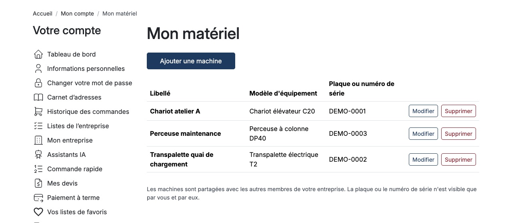
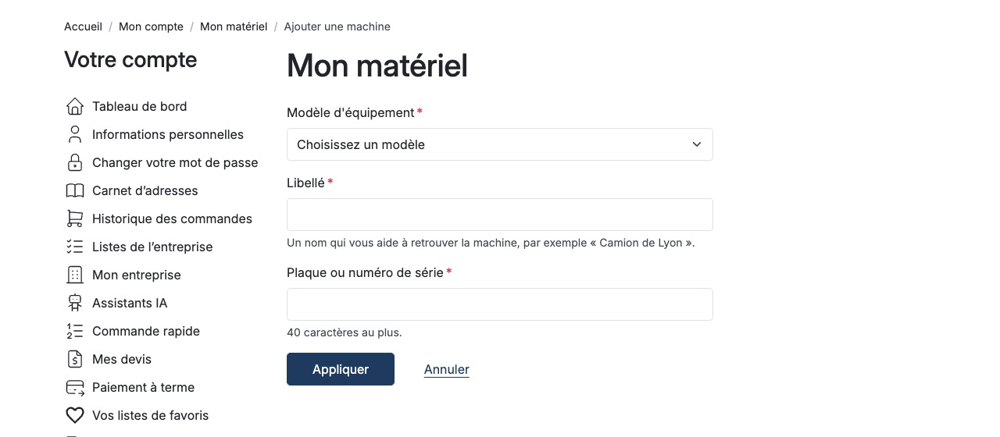
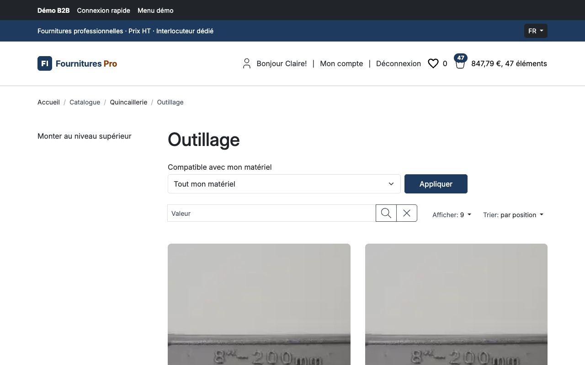
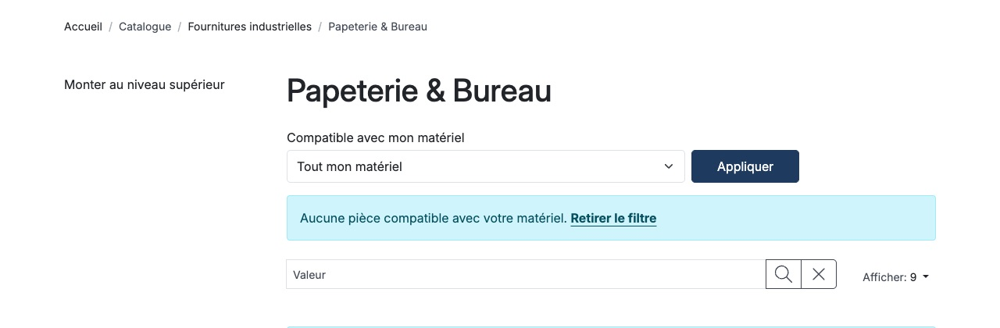
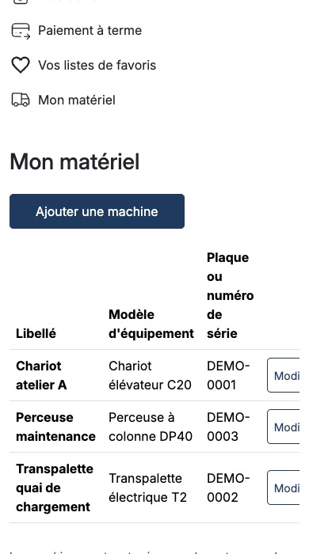

# Sylius Customer Asset Management Plugin

> English: [README.md](README.md) <!-- vitrine:lang -->

[](LICENSE)

Un client B2B déclare l'équipement qu'il possède (« Camion modèle X, plaque AB-123-CD ») dans son
compte, et le catalogue peut être filtré sur les pièces détachées compatibles. Comportement :
[`SPEC.md`](SPEC.md) ; décisions : [`docs/adr/`](docs/adr/).

**Statut : 0.1.1 publiée sur [Packagist](https://packagist.org/packages/tmonier/sylius-customer-asset-management-plugin).**

## Prérequis

| | Versions prises en charge |
|---|---|
| PHP | 8.2, 8.3, 8.4, 8.5 |
| Sylius | 2.2 (2.2.9+) et 2.3 |
| Symfony | 6.4, 7.4, 8.0 (8.0 avec Sylius 2.3) |
| Base de données | MySQL 8.4, MariaDB 11.4, PostgreSQL 17 |

## Installation

```bash
composer require tmonier/sylius-customer-asset-management-plugin
```

Déclarez le bundle dans `config/bundles.php` :

```php
Tmonier\SyliusCustomerAssetManagementPlugin\TmonierSyliusCustomerAssetManagementPlugin::class => ['all' => true],
```

Importez la configuration dans `config/packages/_sylius.yaml` et les routes dans `config/routes.yaml` :

```yaml
# config/packages/_sylius.yaml
imports:
    - { resource: "@TmonierSyliusCustomerAssetManagementPlugin/config/config.yaml" }

# config/routes.yaml
tmonier_sylius_customer_asset_management:
    resource: "@TmonierSyliusCustomerAssetManagementPlugin/config/routes.yaml"
```

Lancez les migrations (le plugin ajoute les siennes à la configuration des migrations Doctrine) :

```bash
bin/console doctrine:migrations:migrate
```

## Configuration

```yaml
tmonier_sylius_customer_asset_management:
    # Rôle nécessaire à un administrateur pour gérer les modèles d'équipement (par défaut : tout administrateur).
    admin_role: ROLE_ADMINISTRATION_ACCESS
    # Nombre de machines qu'un client peut déclarer.
    max_assets_per_customer: 50
```

## Administration : modèles d'équipement et compatibilité

*Catalogue > Modèles d'équipement* liste, crée, modifie et supprime les modèles d'équipement (un code
unique de 64 caractères au plus, et un nom par langue). Le code n'est plus modifiable une fois le
modèle créé. Un modèle sans nom dans la langue de l'administration est affiché par son code.

Sur le formulaire d'une variante, *Modèles d'équipement compatibles* coche les modèles sur lesquels
la variante se monte. La compatibilité est par variante, pas par produit. Supprimer un modèle retire
ses liens de compatibilité, jamais les variantes. La liste indique le nombre de variantes de chaque modèle.

Pour restreindre les écrans, donnez à `admin_role` un rôle à vous (par exemple `ROLE_EQUIPMENT_MANAGER`)
et attribuez-le aux administrateurs concernés : les autres reçoivent un 403 sur les écrans des modèles
et ne voient pas le champ du formulaire de variante.

## Espace client : « Mon matériel »

Un client connecté trouve *Mon matériel* dans le menu de son compte (`/{_locale}/account/equipment`) :
liste, ajout, modification et suppression de ses machines (modèle d'équipement, libellé, plaque ou
numéro de série de 40 caractères au plus) ; une suppression se confirme d'abord sur une page dédiée. Un client peut déclarer jusqu'à `max_assets_per_customer` machines.

- **Page d'une machine.** Chaque machine de la liste ouvre sa page (`/{_locale}/account/equipment/{id}`) : libellé, modèle d'équipement, plaque ou numéro de série et date d'ajout. La page expose le hook Twig `tmonier_equipment_shop.account.equipment_show.extensions` (contexte : `asset`, `equipment_model`) où un autre plugin peut ajouter un bloc, par exemple le passeport produit du modèle d'équipement.

- **Cloisonnement.** Un client ne voit et ne modifie que son propre parc. Avec
  [`tmonier/sylius-company-accounts-plugin`](https://github.com/thibmonier/sylius-company-accounts-plugin)
  installé, le parc est partagé avec les membres actifs de l'entreprise du client ; le plugin fonctionne
  sans (simple `suggest`, détecté à la construction du conteneur).
- **Parc commun à l'entreprise.** Avec le plugin de comptes entreprise, le parc est commun à la société :
  tout membre actif peut voir, modifier et supprimer chaque machine, quel que soit celui qui l'a déclarée.
- **Plafond.** `max_assets_per_customer` est un plafond applicatif vérifié avant l'insertion ; il n'est pas
  garanti sous requêtes simultanées (quelques machines de plus peuvent passer). Ce risque est accepté.
- **Pas de fuite d'existence.** Les machines sont référencées par un UUID, jamais par un entier.
  L'identifiant d'une machine d'autrui, un identifiant inconnu et un identifiant qui n'est pas un UUID
  répondent tous **404**, jamais 403. Chaque route est autorisée par un voter sur la machine, et toute
  saisie est validée côté serveur.
- **Données personnelles.** Une plaque ou un numéro de série peut identifier une personne (entrepreneur
  individuel) : c'est une donnée personnelle au sens du RGPD. Elle n'est jamais écrite dans un journal,
  jamais placée dans une URL, et supprimée avec le compte client (`ON DELETE CASCADE` et un écouteur Doctrine).
- **Limitation du débit** de la création de machines : laissée à votre application (par exemple le
  rate limiter de Symfony sur la route `tmonier_equipment_shop_fleet_create`).
- Un modèle d'équipement utilisé par au moins une machine ne peut pas être supprimé en administration.

## Catalogue : « Compatible avec mon matériel »

Sur la liste d'une catégorie (et sur sa recherche), un client connecté **dont le parc n'est pas vide**
voit un contrôle *Compatible avec mon matériel* au-dessus des produits. Il choisit *Tout mon matériel*
(par défaut une fois le filtre activé), une machine, ou *Toutes les pièces* pour retirer le filtre. La
liste n'affiche alors que les produits qui ont une variante active compatible avec la ou les machines
choisies. Le choix est conservé en session, donc il suit le client de page en page et de catégorie en
catégorie, et il figure dans l'URL (`?equipment=all` ou `?equipment=<uuid de la machine>`), donc la
pagination et le tri le gardent.

- Un visiteur, un client sans machine, ou un identifiant qui n'est pas dans le parc du client (machine
  d'un autre client, identifiant inconnu) : pas de contrôle, ou le filtre se replie sur *Tout mon
  matériel*. Rien ne révèle qu'une machine étrangère existe, et la liste n'est jamais une page vide par accident.
- Quand aucun produit ne convient, la page le dit et propose *Retirer le filtre*.
- Le filtre étend la requête de liste des produits de Sylius par une sous-requête `EXISTS` ; il n'a
  besoin d'aucun moteur de recherche, et ne coûte aucune requête tant que le client ne le sélectionne
  pas (le contrôle lit le parc une fois).
- **Limite.** Le filtre s'applique à la grille `sylius_shop_product` (catégories et leur recherche).
  Une liste qui ne passe pas par cette grille (contrôleur sur mesure, collection d'API, moteur de
  recherche) demande son propre point d'accroche : le plugin ne la modifie pas.

## Captures d'écran












## Développement

Prérequis : PHP 8.2+, Composer, une base MySQL (voir `tests/TestApplication/.env`).

```bash
composer install
php -d memory_limit=2G vendor/bin/ecs check
php -d memory_limit=2G vendor/bin/phpstan analyse
vendor/bin/rector process --dry-run
php -d memory_limit=2G vendor/bin/phpunit
```

<!-- vitrine:demo-b2b:start -->
## Démo B2B

Ce plugin est utilisé dans la [démo B2B Sylius](https://github.com/thibmonier/sylius-b2b-demo) : une boutique Sylius 2.3 avec des données d'exemple fictives, où les plugins B2B fonctionnent ensemble. Le code source, l'installation et les fixtures de la démo sont dans ce dépôt.

- Démo en ligne : [sylius-b2b.thibaut-monier.fr](https://sylius-b2b.thibaut-monier.fr)
- Auteur : [Thibaut Monier](https://www.linkedin.com/in/thibautmonier/)

La démo est un exemple, pas une configuration de production.
<!-- vitrine:demo-b2b:end -->

## Licence

MIT, voir [LICENSE](LICENSE).
