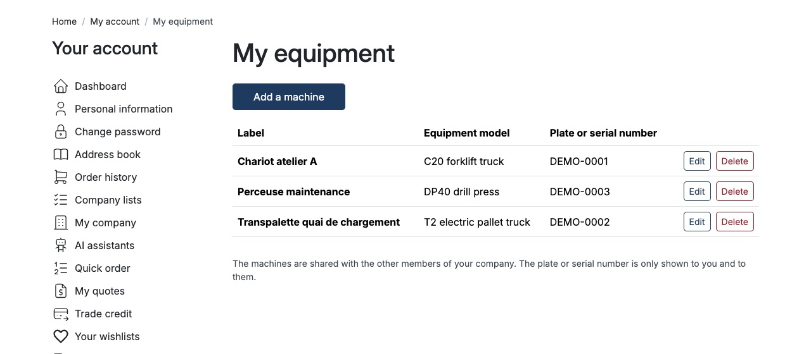
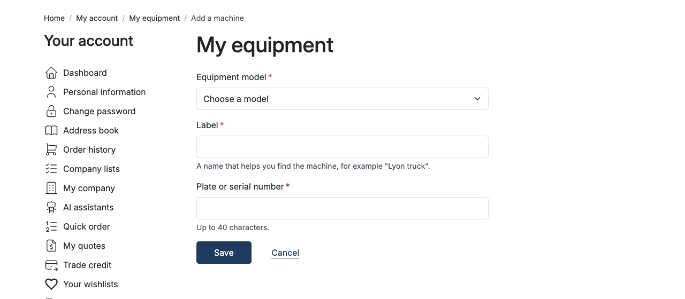
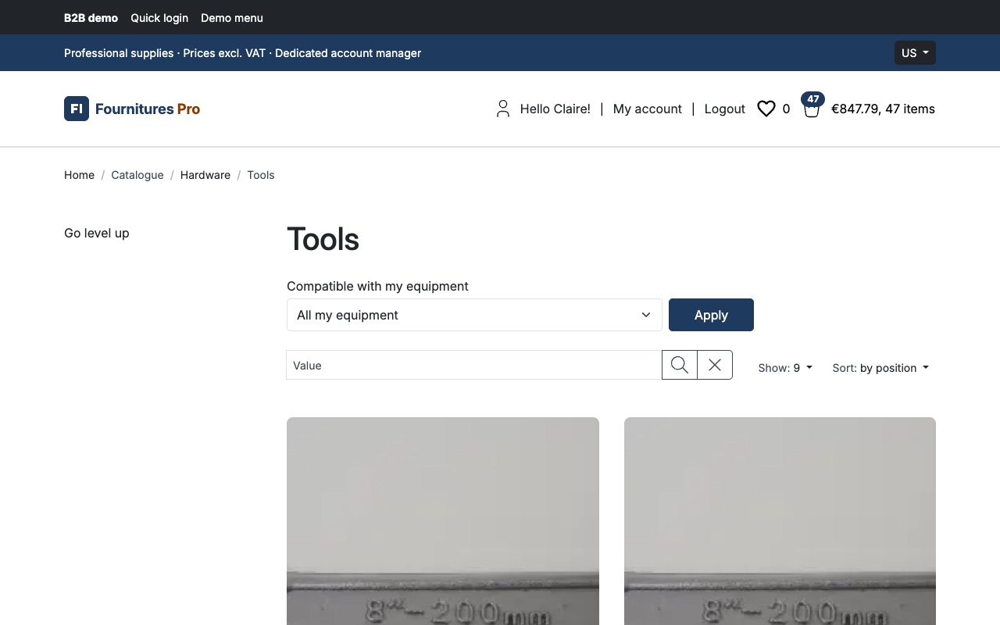
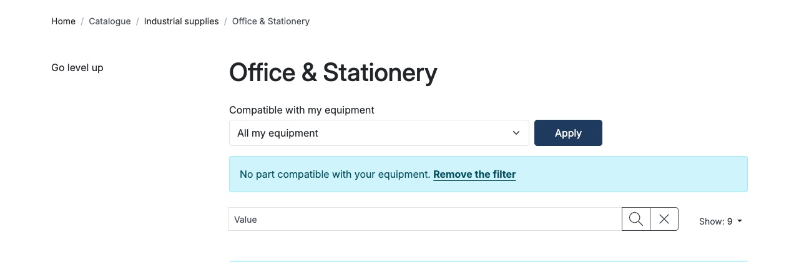
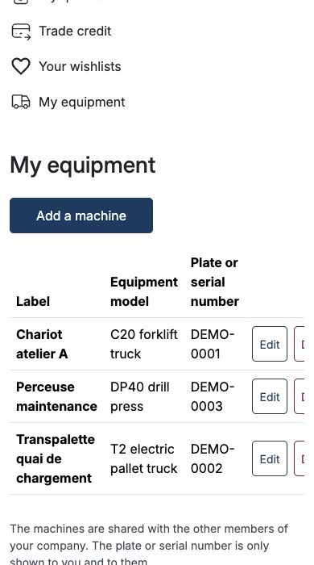

# Sylius Customer Asset Management Plugin

> Français : [README.fr.md](README.fr.md) <!-- vitrine:lang -->

[](LICENSE)

A B2B customer declares the equipment they own ("Truck model X, plate AB-123-CD") in their account,
and the catalogue can be filtered to the spare parts compatible with it. Behaviour: [`SPEC.md`](SPEC.md);
decisions: [`docs/adr/`](docs/adr/).

**Status: 0.1.1 released on [Packagist](https://packagist.org/packages/tmonier/sylius-customer-asset-management-plugin).**

## Requirements

| | Supported |
|---|---|
| PHP | 8.2, 8.3, 8.4, 8.5 |
| Sylius | 2.2 (2.2.9+) and 2.3 |
| Symfony | 6.4, 7.4, 8.0 (8.0 with Sylius 2.3) |
| Database | MySQL 8.4, MariaDB 11.4, PostgreSQL 17 |

## Installation

```bash
composer require tmonier/sylius-customer-asset-management-plugin
```

Register the bundle in `config/bundles.php`:

```php
Tmonier\SyliusCustomerAssetManagementPlugin\TmonierSyliusCustomerAssetManagementPlugin::class => ['all' => true],
```

Import the configuration in `config/packages/_sylius.yaml` and the routes in `config/routes.yaml`:

```yaml
# config/packages/_sylius.yaml
imports:
    - { resource: "@TmonierSyliusCustomerAssetManagementPlugin/config/config.yaml" }

# config/routes.yaml
tmonier_sylius_customer_asset_management:
    resource: "@TmonierSyliusCustomerAssetManagementPlugin/config/routes.yaml"
```

Run the migrations (the plugin prepends its own to the Doctrine migrations configuration):

```bash
bin/console doctrine:migrations:migrate
```

## Configuration

```yaml
tmonier_sylius_customer_asset_management:
    # Role an administrator needs to manage the equipment models (default: any administrator).
    admin_role: ROLE_ADMINISTRATION_ACCESS
    # Number of machines a customer can declare.
    max_assets_per_customer: 50
```

## Administration: equipment models and compatibility

*Catalog > Equipment models* lists, creates, edits and deletes the equipment models (a code, up to 64
characters and unique, and a name per language). The code cannot be changed once the model exists.
A model without a name in the language of the administration is shown by its code.

On the form of a product variant, *Compatible equipment models* ticks the models the variant fits.
Compatibility is per variant, not per product. Deleting a model removes its compatibility links and
never the variants. The list shows how many variants each model has.

To restrict the screens, set `admin_role` to a role of your own (for example `ROLE_EQUIPMENT_MANAGER`)
and give it to the administrators concerned: the others get a 403 on the model screens and do not
see the field on the variant form.

## Customer account: "My equipment"

A signed-in customer finds *My equipment* in the menu of their account (`/{_locale}/account/equipment`):
list, add, edit and delete their machines (equipment model, label, plate or serial number of up to
40 characters); a deletion is confirmed on a page of its own first. A customer can declare up to `max_assets_per_customer` machines.

- **Machine page.** Each machine of the list opens its own page (`/{_locale}/account/equipment/{id}`): label, equipment model, plate or serial number and the date it was added. The page exposes the Twig hook `tmonier_equipment_shop.account.equipment_show.extensions` (context: `asset`, `equipment_model`) where another plugin can add a block, for example the product passport of the equipment model.

- **Isolation.** A customer sees and changes only their own fleet. With
  [`tmonier/sylius-company-accounts-plugin`](https://github.com/thibmonier/sylius-company-accounts-plugin)
  installed, the fleet is shared with the active members of the customer's company; the plugin works
  without it (it is a `suggest`, detected when the container is built).
- **Shared by the company.** With the company accounts plugin the fleet is common to the company:
  every active member can see, edit and delete every machine of it, whoever declared it.
- **Limit.** `max_assets_per_customer` is an application-level cap checked before the insert; it is
  not guaranteed under simultaneous requests (a few machines more can slip through). This risk is accepted.
- **No leak of existence.** Machines are referenced by an UUID, never by an integer. The id of a
  machine of someone else, an unknown id and an id that is not an UUID all answer **404**, never 403.
  Every route is authorised by a voter on the machine, and every input is validated on the server.
- **Personal data.** A plate or a serial number can identify a person (sole trader), so it is
  personal data under the GDPR: it is never written to a log, never put in a URL, and it is deleted
  with the customer account (`ON DELETE CASCADE` and a Doctrine listener).
- **Rate limiting** of the creation of machines is left to your application (for example the Symfony
  rate limiter on the route `tmonier_equipment_shop_fleet_create`).
- An equipment model used by at least one machine cannot be deleted in the administration.

## Catalogue: "Compatible with my equipment"

On the listing of a category (and on its search), a signed-in customer **whose fleet is not empty**
gets a *Compatible with my equipment* control above the products. They choose *All my equipment*
(the default once the filter is enabled), one machine, or *All parts* to remove the filter. The
listing then only shows the products that have an enabled variant compatible with the chosen
machine(s). The choice is kept in the session, so it follows the customer from page to page and
category to category, and it is in the URL (`?equipment=all` or `?equipment=<uuid of the machine>`),
so the pagination and the sorting keep it.

- A visitor, a customer without machine, or an id that is not in the customer's fleet (another
  customer's machine, an unknown id): no control, or the filter falls back to *All my equipment*.
  Nothing tells that a foreign machine exists, and the listing is never an empty page by accident.
- When no product fits, the page says so and offers *Remove the filter*.
- The filter extends the product listing query of Sylius with an `EXISTS` sub-select; it needs no
  search engine, and it costs no query as long as the customer does not select it (the control
  itself reads the fleet once).
- **Limit.** The filter is applied to the grid `sylius_shop_product` (categories and their search).
  A listing that does not go through that grid (a custom controller, an API collection, a search
  engine) needs its own hook: the plugin does not change it.

## Screenshots












## Development

Requirements: PHP 8.2+, Composer, a MySQL database (see `tests/TestApplication/.env`).

```bash
composer install
php -d memory_limit=2G vendor/bin/ecs check
php -d memory_limit=2G vendor/bin/phpstan analyse
vendor/bin/rector process --dry-run
php -d memory_limit=2G vendor/bin/phpunit
```

<!-- vitrine:demo-b2b:start -->
## B2B demo

This plugin is used in the [Sylius B2B demo](https://github.com/thibmonier/sylius-b2b-demo): a Sylius 2.3 shop with fictitious sample data where the B2B plugins work together. The source code, setup and fixtures of the demo are in that repository.

- Online demo: [sylius-b2b.thibaut-monier.fr](https://sylius-b2b.thibaut-monier.fr)
- Author: [Thibaut Monier](https://www.linkedin.com/in/thibautmonier/)

The demo is an example, not a production setup.
<!-- vitrine:demo-b2b:end -->

## License

MIT, see [LICENSE](LICENSE).
